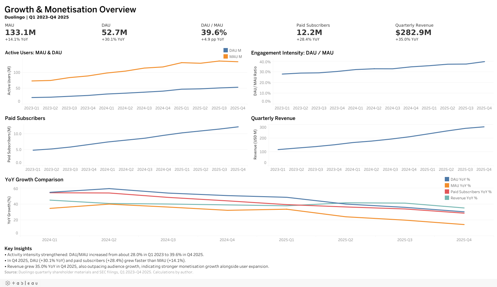
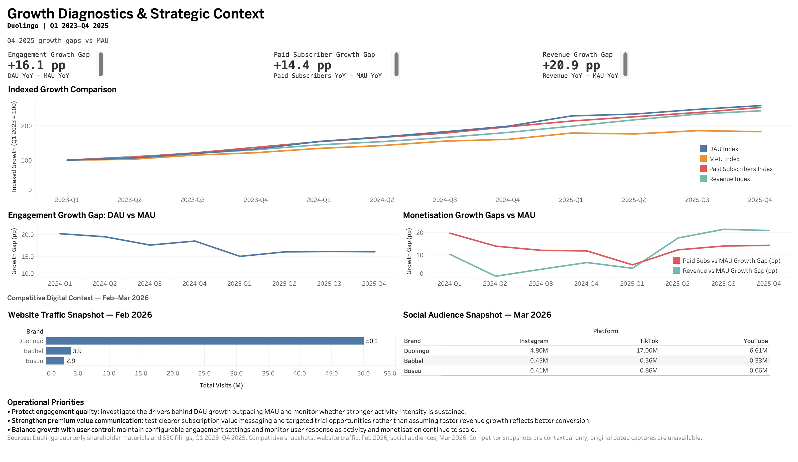

# Duolingo Growth & Marketing Operations Analytics

**Portfolio focus:** Growth Operations / User Operations / Product Operations / General Operations

This project extends a Digital Marketing Strategy coursework case study of Duolingo into a data-driven growth and operations analysis. Rather than treating the dashboard as a technical exercise, the analysis asks a business question: **as Duolingo's audience expanded, did engagement and monetisation quality strengthen with it?**

[Read the case study](case_study/case_study_en.html) · [PDF](case_study/Duolingo_Growth_Operations_Case_Study_EN.pdf) · [Editable slides](case_study/Duolingo_Growth_Operations_Case_Study_EN.pptx) · [中文版本](README_CN.md)

## Business questions

1. How did Duolingo's audience, daily engagement, paid subscriber base and revenue evolve from 2023 to 2025?
2. Did engagement and monetisation grow faster or slower than overall audience scale?
3. What do the February 2026 website and March 2026 social snapshots add to the strategic context?
4. What should a growth/operations team monitor or investigate next?

## Data scope

- **Analysis as of:** March 2026
- **Corporate performance:** Q1 2023-Q4 2025 (12 quarters)
- **Competitive website snapshot:** February 2026
- **Social-media snapshot:** March 2026

The company-performance dataset is sourced from Duolingo Investor Relations and SEC filings. Competitive snapshots preserve figures inherited from historical coursework snapshots. The original coursework and dated captures are absent from this repository, so their historical provenance cannot be independently verified. See [source manifest](docs/source_manifest.csv).

## Final Tableau dashboards

The two completed English Tableau dashboards are the final visualisation for this portfolio. Open [Page 1 on Tableau Public](https://public.tableau.com/views/Duolingo_Growth_Marketing_Analytics/P1_Growth_Monetisation_Overview?:language=en-US&:sid=&:redirect=auth&:display_count=n&:origin=viz_share_link) or [Page 2 on Tableau Public](https://public.tableau.com/views/Duolingo_Growth_Marketing_Analytics/P2_Growth_Diagnostics_Strategic_Context?:showVizHome=no), or download the [final native workbook](dashboard/final/Duolingo_Growth_Marketing_Analytics.twbx). Both pages' public image exports were retrieved without sign-in on **October 18, 2026**; interactive browser tabs were not tested. Links are maintained in [the central portfolio link record](docs/portfolio_links.json).

### Page 1 - Growth & Monetisation Overview

### Page 2 - Growth Diagnostics & Strategic Context

The final Page 2 contains Q4 2025 growth-gap cards, **Indexed Growth Comparison**, **Engagement Growth Gap**, **Monetisation Growth Gaps**, separate **Website Traffic** (February 2026) and **Social Audience** (March 2026) contextual snapshots, and **Operational Priorities**.

## Key findings

- **Engagement deepened much faster than reach.** From Q1 2023 to Q4 2025, MAU grew **83%**, while DAU grew **160%**. DAU/MAU increased from **28.0% to 39.6% (+11.6 pp)**.
- **Monetisation scaled ahead of audience size.** Paid subscribers rose **154%** and quarterly revenue **145%** over the same period, both well above MAU growth.
- **The growth mix changed in 2025.** By Q4 2025, MAU growth had moderated to **14% YoY**, while DAU, paid subscribers and revenue still grew **30%, 28% and 35% YoY**, respectively.
- **Duolingo leads digital reach in the supplied February-March 2026 snapshots.** Website visits were 50.1M versus 3.9M for Babbel and 2.9M for Busuu, while Duolingo also led all three observed social platforms. These inherited figures provide point-in-time context, with unverified historical captures. They do not establish market share, conversion or retention.

## Operational implications

1. **Protect engagement quality.** Investigate the drivers behind DAU growth outpacing MAU and monitor whether stronger activity intensity is sustained.
2. **Strengthen premium value communication.** Test clearer subscription value messaging and targeted trial opportunities. Faster revenue growth does not establish better conversion.
3. **Balance growth with user control.** Maintain configurable engagement settings and monitor user response as activity and monetisation continue to scale.

These priorities match the final Tableau dashboard. Proposed reviews and experiments require authorised internal evidence and free-experience guardrails; they do not establish a current product deficiency or implemented business impact.

## Limitations

- Public aggregate data only; no internal user-level data.
- No real free-to-paid funnel, campaign ROI or retention cohorts.
- Competitor web/social metrics are inherited point-in-time historical snapshots. Original dated captures are unavailable.
- Company-reported MAU/DAU are estimates based on Duolingo's own analytics definitions and are not independently validated.
- Observed growth relationships are descriptive, not causal.

## Method and tools

- **SQL / Python:** calculate quarterly KPIs, QoQ/YoY changes, indexed growth and growth-rate gaps, then reconcile the results against independent calculations. The scope and formulas remain frozen.
- **Tableau:** present the findings in the final two-page workbook. See [delivery status](TABLEAU_HANDOFF.md) and [workbook maintenance guide](docs/tableau_build_guide.md).
- **Verification boundary:** SQL formulas were executed through a documented SQLite compatibility adaptation; native MySQL execution has not been verified. See [methodology](docs/methodology.md) for the full definitions and checks.

The project uses public evidence to support operational questions; it does not invent funnels, campaign metrics or implemented business impact.

## Repository structure

- `data/` raw and processed datasets
- `sql/` MySQL 8+ analysis scripts
- `notebooks/` executed Python QA/analysis notebook
- `dashboard/final/` final English Tableau dashboard images
- Earlier static prototype directories remain in the working repository for history and are excluded from the final distribution ZIP
- `docs/` source manifest, data dictionary and methodology
- `case_study/` bilingual portfolio case-study files

## Deliverables and verification

- English: [HTML](case_study/case_study_en.html) / [PDF](case_study/Duolingo_Growth_Operations_Case_Study_EN.pdf) / [editable slides](case_study/Duolingo_Growth_Operations_Case_Study_EN.pptx)
- Chinese: [HTML](case_study/case_study_cn.html) / [PDF](case_study/Duolingo_Growth_Operations_Case_Study_CN.pdf) / [editable slides](case_study/Duolingo_Growth_Operations_Case_Study_CN.pptx)
- [Chinese README](README_CN.md), [methodology](docs/methodology.md), [data dictionary](docs/data_dictionary.md)
- [Independent review](REVIEW_REPORT.md), [final QA](FINAL_QA.md), [change log](CHANGELOG.md), [Tableau build guide](docs/tableau_build_guide.md)

The original coursework motivates the questions. This repository establishes its findings from the official corporate data and clearly qualified competitor snapshots.

## Rebuilding and maintenance

Install `requirements.txt` into an isolated Python environment, then run `python src/build_project.py` from the project folder. This executes the QA notebook and rebuilds the legacy static prototype assets. Already-correct processed CSVs are retained verbatim; canonical raw inputs, SQL, source documentation and case-study prose are preserved. Use `--check-only` for read-only data/SQL verification, or `--only dashboards` / `--only notebook` for a focused refresh. A Chinese font is required; `--cn-font-path` accepts a local font file when automatic discovery is unavailable.

The separate `src/build_case_studies.mjs` refreshes the existing seven-slide templates, paired PDFs and HTML using the Codex presentation runtime and headless renderer. It documents environment overrides for the runtime paths. Review exported pages after a content or asset change. The final Tableau workbook and its images remain the presentation reference. Historical QA records describe earlier checks; current publication verification covers unauthenticated image exports for both final pages.
